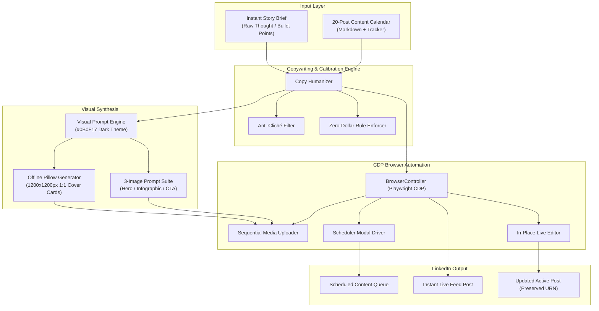

# LinkedIn Post Generator

[](LICENSE)
[](https://www.python.org/)
[](https://playwright.dev/)
[](CONTRIBUTING.md)

An autonomous, open-source publishing engine and content operations framework for B2B founders, agency operators, and executive leaders.

Combines programmatic copy calibration, dark-mode visual synthesis, and Chrome Remote Debugging Protocol (CDP) browser automation to execute multi-week content campaigns and instant on-demand thought leadership posts.

---

## Highlights

- **20-Post B2B Content Sequence:** Production-grade calendar covering operations bottlenecks, lead response latency, CRM reactivation, document chasing, after-hours AI intake, and workflow debt.
- **Instant Post Generator:** Go from raw thought or rough bullet points to an anti-cliché calibrated post and 1:1 visual cover slide in seconds.
- **Copy Humanizer Engine:** Programmatically detects and strips corporate buzzwords and AI clichés (*"game changer"*, *"delve"*, *"supercharge"*, *"tapestry"*, *"revolutionize"*). Enforces the **Zero-Dollar Rule** and mobile line-break rhythm.
- **B2B SaaS Visual Design System:** Dark-mode cyber slate aesthetic (`#0B0F17`) with 3-image sequential storytelling (Hero, Infographic Flow, and CTA Card). Includes an offline Pillow generator for 1200x1200px cover graphics.
- **Reliable CDP Automation:** Connects to your existing Chrome browser session via Playwright without triggering 2FA re-verification or invalidating cookies.
- **In-Place Live Post Editing:** Edit active LinkedIn posts directly in the feed without deleting, preserving likes, comments, and post permalinks.

---

## System Architecture



---

## Directory Structure

```text
linkedin-post-generator/
├── .env.example                     # Environment configuration template
├── .gitignore                       # Git ignore rules
├── LICENSE                          # MIT License
├── README.md                        # Master project documentation
├── requirements.txt                 # Python dependencies
├── assets/                          # Media assets directory
│   └── sample/                      # Sample 1:1 cover cards and guidelines
├── config/
│   └── settings.example.json        # Design tokens and copywriting guidelines
├── content_calendar/
│   ├── CONTENT_CALENDAR_20_POSTS.md # Master overview of the 20-post sequence
│   ├── TRACKER.md                   # Human-readable status board
│   ├── tracker.json                 # Machine-readable lifecycle tracker
│   └── posts/                       # 20 pre-written B2B operational posts
│       ├── post_01_lead_problem.md
│       ├── post_02_recovering_5_abandoned_applications.md
│       └── ...
├── docs/
│   ├── ARCHITECTURE.md              # Detailed architecture documentation
│   └── WORKFLOW_GUIDE.md            # Step-by-step operational workflows
├── generator/
│   ├── __init__.py                  # Package exports
│   ├── browser_controller.py        # Playwright CDP automation layer
│   ├── copy_humanizer.py            # Anti-cliché & zero-dollar rule engine
│   ├── visual_prompt_engine.py      # Prompt generator & offline PIL card maker
│   ├── content_calendar_scheduler.py# CLI for calendar batch management
│   └── instant_post_generator.py    # CLI for on-demand posts & live editing
└── skills/                          # Workflow playbooks and prompt guides
    ├── humanizer_guide.md           # Prompting principles for founder copy
    ├── linkedin_notemaker_skill.md  # LinkedIn connection note craft
    ├── linkedin_poster_playbook.md  # Browser automation execution playbook
    ├── visual_design_system.md      # Color tokens, typography, and card rules
    └── instant_linkedin_posts/
        └── SKILL.md                 # Agent skill definition
```

---

## Quickstart

### 1. Installation

Clone the repository and set up a Python virtual environment:

```bash
git clone https://github.com/your-username/linkedin-post-generator.git
cd linkedin-post-generator

python -m venv venv
# Windows:
.\venv\Scripts\activate
# macOS / Linux:
source venv/bin/activate

pip install -r requirements.txt
playwright install chromium
```

### 2. Configure Environment

Copy `.env.example` to `.env`:
```bash
cp .env.example .env
```

### 3. Launch Chrome with Remote Debugging

Launch Chrome with a dedicated debugging port so the automation engine can connect to your logged-in session:

**Windows:**
```powershell
chrome.exe --remote-debugging-port=9222 --user-data-dir="C:\ChromeDebugProfile"
```

**macOS / Linux:**
```bash
google-chrome --remote-debugging-port=9222 --user-data-dir="/tmp/chrome-debug"
```

*Log into LinkedIn once in this browser window. Playwright will connect directly without requiring passwords or handling 2FA tokens.*

---

## CLI Usage

### Workflow 1: Content Calendar Batch Scheduler

**List all posts and their statuses:**
```bash
python -m generator.content_calendar_scheduler --list
```

**Dry-run copy validation for Post #3:**
```bash
python -m generator.content_calendar_scheduler --post-id 3
```

**Schedule Post #3 live on LinkedIn:**
```bash
python -m generator.content_calendar_scheduler --post-id 3 --execute
```

---

### Workflow 2: Instant Post Generator

**Generate a post with an offline 1200x1200px cover graphic (Dry-Run):**
```bash
python -m generator.instant_post_generator \
  --headline "Speed Over Savings" \
  --body "We spent weeks trying to save 20% on software. What we lost was execution time. Optimize for cycle time, not penny-pinching." \
  --category "FOUNDER LESSON"
```

**Publish immediately live to LinkedIn:**
```bash
python -m generator.instant_post_generator \
  --headline "Speed Over Savings" \
  --body "We spent weeks trying to save 20% on software. What we lost was execution time. Optimize for cycle time, not penny-pinching." \
  --category "FOUNDER LESSON" \
  --publish
```

---

### Workflow 3: In-Place Live Post Editing

Update a live post's copy without deleting the post or losing existing comments/reactions:

```bash
python -m generator.instant_post_generator \
  --edit-url "https://www.linkedin.com/feed/update/urn:li:activity:7123456789012345678/" \
  --new-copy "Revised post copy goes here..."
```

---

## Design System & Tokens

Visual assets adhere to a B2B SaaS Dark Theme:

| Token | Hex Value | Application |
| :--- | :--- | :--- |
| **Obsidian Dark** | `#0B0F17` | Canvas background, post cards |
| **Cyber Slate** | `#161F30` | Inner containers, diagram nodes |
| **Electric Cyan** | `#00F0FF` | Primary highlights, accent bars, badges |
| **Emerald Green** | `#10B981` | Success states, optimized workflow flows |
| **Text Primary** | `#F8FAFC` | Main headlines, key statistics |
| **Text Secondary**| `#94A3B8` | Subtitles, supporting notes, labels |

---

## Core Copywriting Principles

1. **The Zero-Dollar Rule:** Never use the `$` sign. Reframe financial discussions around operational leverage, capacity, hours saved, or conversion percentages.
2. **Anti-Cliché Heuristics:** Strip phrases like *"in today's fast-paced world"*, *"supercharge"*, *"unlock"*, and *"game changer"*.
3. **Mobile-First Scannability:** Keep hook lines under 90 characters. Write in 1-2 sentence rhythmic beats. Use whitespace intentionally.
4. **Frictionless CTA:** Close with a low-commitment conversational trigger or single DM keyword (e.g., *"DM 'AFTERHOURS' for the system map"*).

---

## Documentation

- [System Architecture](docs/ARCHITECTURE.md)
- [Workflow Guide & Operational Manual](docs/WORKFLOW_GUIDE.md)
- [Visual Design System](skills/visual_design_system.md)
- [Copy Humanizer Guide](skills/humanizer_guide.md)

---

## Contributing

Contributions, feedback, and pull requests are welcome! Please ensure all code adheres to PEP 8 standards and new features include dry-run validation support.

---

## License

Distributed under the [MIT License](LICENSE).
