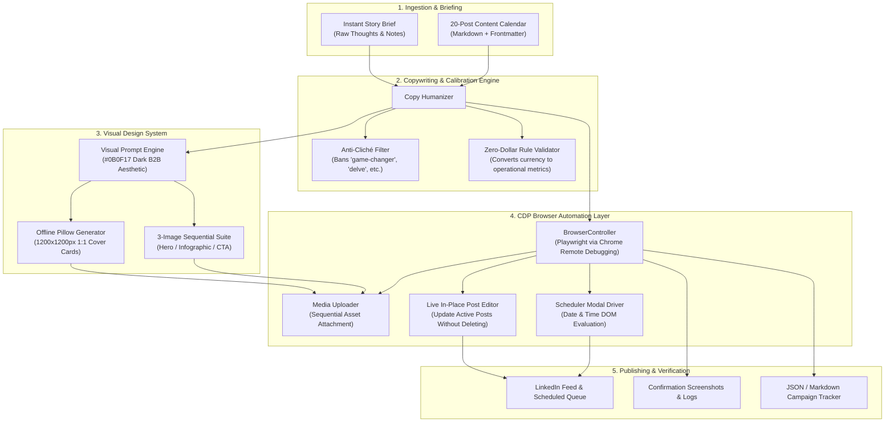

# System Architecture

The **LinkedIn Post Generator** is an autonomous, open-source publishing framework designed for founders, agency operators, and B2B tech leaders. It pairs programmatic copy generation, visual design synthesis, and Chrome DevTools Protocol (CDP) browser automation to deliver reliable scheduled campaigns and instant thought leadership posts.

---

## 1. High-Level Architecture Diagram

---

## 2. Core Components

### 2.1 Content Calendar Framework (`content_calendar/`)
- **20 Pre-Built Posts:** Ready-to-publish mortgage and insurance operations posts covering pipeline leakage, CRM reactivation, after-hours AI intake, document chasing, renewal automation, and operational debt.
- **Tracker Engine (`tracker.json` & `TRACKER.md`):** State persistence tracking post lifecycle (`draft` → `staged` → `scheduled` → `published`).

### 2.2 Copy Humanizer & Style Enforcer (`generator/copy_humanizer.py`)
- **Anti-Cliché Filtering:** Programmatically blocks robotic corporate jargon (`game changer`, `dive deep`, `delve`, `revolutionize`, `supercharge`, `tapestry`, `leverage`).
- **The Zero-Dollar Rule:** Enforces the elimination of raw `$` symbols, reframing discussions around hours saved, pipeline capacity, conversion percentages, or operational efficiency.
- **Mobile Readability Rules:** Guarantees punchy 1-2 sentence beats, short hook lines (<90 characters), and clean footer hashtags (max 2-3).

### 2.3 Visual Design Engine (`generator/visual_prompt_engine.py`)
- **B2B SaaS Theme Tokens:** Consistent color schemes featuring Obsidian Dark (`#0B0F17`), Cyber Slate (`#161F30`), Electric Cyan (`#00F0FF`), and Emerald Green (`#10B981`).
- **3-Image Visual Sequences:**
  1. *Hero Slide:* High-contrast contrarian question or bold hook.
  2. *Infographic Diagram:* Operational flow, comparison matrix, or node-and-arrow system map.
  3. *Call to Action:* High-curiosity question paired with a specific DM keyword.
- **Built-in Pillow Generator:** Generates 1200x1200px 1:1 square cover graphics completely offline with no external API keys required.

### 2.4 Browser Automation Layer (`generator/browser_controller.py`)
- **Chrome Remote Debugging Protocol (CDP):** Connects to a persistent user Chrome session (port 9222) via Playwright. Avoids repeated 2FA challenges, prevents session invalidation, and preserves user login state.
- **Sequential Multi-Image Upload:** Attaches up to 3 visual assets in strict order (Hero → Infographic → CTA).
- **Date & Time Picker Automation:** Interacts with LinkedIn's scheduling dialog with zero flakiness.
- **In-Place Live Editing:** Modifies published post text directly via the feed interface without deleting the post or losing existing comments/reactions.

---

## 3. Data & Privacy Safeguards

- **Zero Hardcoded Secrets:** All configuration is managed via `.env` or `config/settings.json`.
- **Zero Personal Data:** The repository contains only generic, professional examples. No real user identifiers, emails, API keys, or private profiles are committed.
- **Non-Destructive Execution:** The browser automation connects to existing sessions without terminating browsers or modifying local browser profiles.
